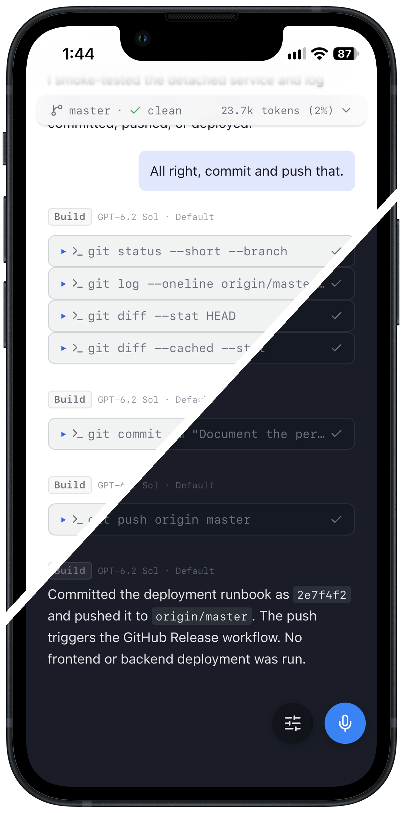
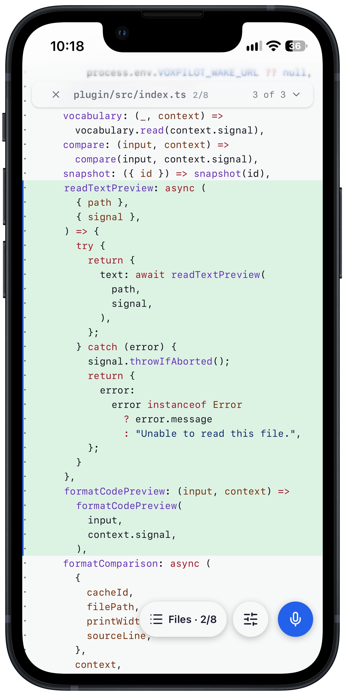

# VoxPilot

Mobile-first coding UI for [OpenCode 2](https://opencode.ai/v2/docs/). VoxPilot
formats both versions of a file to the phone's character width **before**
computing the diff, including comment reflow.

## Highlights

**Do everything by voice, even managing the chat.** The agent can act on the
conversation you’re using, not just the code. Say, “Move this chat into a new
worktree,” or “Fork this conversation from before we changed the API,” then
keep talking.

<p align="center">
  
</p>

**Format first, then diff.** VoxPilot formats both the before and after versions
to your screen width, using tools like Prettier for TypeScript and Ruff for
Python, then compares them. A long function call breaks across lines at its
arguments instead of wherever the screen runs out of room. The files on disk
stay untouched, so the review won’t line up line-for-line with them.

<p align="center">
  
</p>

## Architecture

- **Static frontend:** build once, serve on your Caddy host, connect to any host.
- **Native OpenCode plugin:** formatting RPCs, persistent review snapshots,
  `voxpilot_show_diff` agent tool, and desktop idle inhibition.
- **systemd service:** runs `opencode serve` directly via an `exec` launcher.
  OpenCode owns plugin lifecycle, HTTP authentication, API, and SSE.

There is no VoxPilot HTTP backend or MCP server. Plugin source and shared RPC
schemas live in `plugin/`; the frontend imports their inferred types.

## Development

Prerequisites: Bun, Node.js 22+, just, Git, native OpenCode 2.3.2, Ruff and
clang-format, plus stable rustfmt with Rust 2024 support for Rust reviews.
Prettier is bundled. Provider configuration belongs to OpenCode.

```sh
cp .env.example .env
just install
just dev
```

Vite serves the frontend on port 3000 and proxies `/api` and `/auth` to OpenCode
on port 8001. Development uses the production launcher, including its standard
CORS origins, while overriding the plugin path to the source checkout. Open the
frontend and connect using its own URL and the development server password.
Alternatively, configure named servers and credentials in the Git-ignored
`frontend/config.local.json`; see `packaging/config.example.json` for the format.
Vite serves this runtime file without including it in production builds.
Rebuild the plugin and restart the development server after plugin edits.

```sh
just typecheck
just test       # formatter tests + real isolated OpenCode plugin integration
just test-e2e  # real dev backend; GPT-6 Luna for generated AI responses
just check     # typecheck, both test suites, and lint
just lint
just build     # plugin/dist and frontend/dist
scripts/build-release.sh bun-linux-x64
```

## Voice

The composer starts in Voice mode without opening the keyboard: **Record →
Finish → send**. VoxPilot transcribes the recording and sends it as your
message. Paste captures clipboard text or links as numbered pills, so you can
say "compare link one with link two" while speaking. Tap a pill to inspect its
contents. Type switches to a keyboard composer whenever you need it.

**Speech vocabulary** helps transcription spell project names correctly. Each
list is a plain JSON array of canonical spellings:

| List | Location |
| --- | --- |
| User, on this machine | `$XDG_CONFIG_HOME/voxpilot/vocabulary.json`, default `~/.config/voxpilot/vocabulary.json` |
| Shared project | Active checkout's `.voxpilot/vocabulary.json` (committable) |
| Private project | Canonical checkout's `.voxpilot/vocabulary.local.json` (ignored) |

```json
["VoxPilot", "OpenCode", "SolidJS", "Zod"]
```

Ask the agent to add a word and it edits the right list for you. See
[recorded speech](ARCHITECTURE.md#recorded-speech) for limits, recovery and vocabulary rules.

## More documentation

- [Architecture](ARCHITECTURE.md)
- [Host packaging and manual deployment](packaging/README.md)
- [Personal deployment](packaging/PERSONAL.md)
- [Browser tests](frontend/e2e/README.md)
